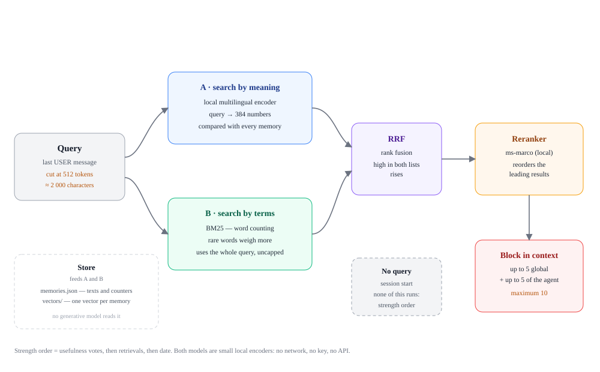

# OESC — Open Electric Sheep Count

> **Version 1.2.0.** The number lives in one line: `global/opencode/plugins/core-brain/VERSION`,
> which the installer copies to `~/.config/opencode/plugins/core-brain/VERSION` — so an agent reads
> the running version with `cat ~/.config/opencode/plugins/core-brain/VERSION`.
> **An install older than 1.2 must migrate before it is used: see [UPDATE.md](UPDATE.md).**

> **Name.** OESC = **O**pen **E**lectric **S**heep **C**ount. "Open" = open source;
> "Electric Sheep" = the Philip K. Dick reference (*Do Androids Dream of Electric
> Sheep?*) — the agent/artificial-mind imagery; "Count" = counting sheep to fall
> asleep, i.e. the **sleep/consolidation ("dreams")** at the heart of the project.

**OESC** provides an **open-source AI framework for OpenCode V2 and a core-brain adaptation for Codex**: a growing
set of **agents**, **skills**, **plugins**, and an **enhanced memory** for LLM
agents — shipped as a complete suite and **prepared for OpenCode V2**
([OpenCode V2 documentation](https://opencode.ai/v2/docs/)).

The suite ships **todo** (§1), **context-inject** (§2), core-brain
memory engine, and the **agent team** (§4). `opencode/codex` contains the working
memory MCP/hook adaptation, native file injector, role prompts, global helpers
and memory skills. The broader tiered-memory, dreams and
mental-map design in §3 remains a roadmap, beyond the implemented memory store.

---

## Getting started

**Install by giving your coding agent the prompt below.** 

```plantext
Visit https://github.com/open-eletric-sheep-count/core-brain and follow the "Agent Instalation Instructions"
```

# 

## Agent Instalation Instructions

Set the target CLI to `opencode`, `codex`, or the name of another CLI that needs an explicit adaptation. The agent should inspect your machine and existing configuration,
then execute and verify the installation. The complete manual is
[INSTALATION.md](INSTALATION.md) at the repository root.

```text
Install OESC core-brain from
https://github.com/open-eletric-sheep-count/core-brain.git.
Target CLI: <opencode | codex | another CLI name>.
Checkout location: <choose a suitable local workspace or reuse my checkout>.

1. Inspect the OS, shell, target CLI/version, Node, Python, existing skills,
   MCPs, hooks and memory paths. Read applicable local AGENTS.md instructions.
   Reuse an existing checkout after inspecting its branch and local changes;
   otherwise clone the Git repository to the selected directory. Preserve work.
2. Read README.md, the root INSTALATION.md and install.sh --help. Check the
   target CLI's current official plugin/skill/MCP/hook documentation. Plan the
   steps and define focused tests before changing installation behavior.
3. For OpenCode V2, run bash install.sh --host opencode --dry-run, then
   bash install.sh --host opencode --install-runtime with the correct paths.
   For Codex, use the same commands with --host codex. Reuse an already
   provisioned real runtime instead of reinstalling it unnecessarily. Select
   --memory-home, --runtime-dir, --models-dir and --skills-dir as needed.
   Full installation also installs global helpers and role prompts. For Codex,
   source global/codex/rules maps to CODEX_HOME/roles, and helpers maps to
   CODEX_HOME/helpers. Check injector file paths in the installed layout as
   explained in INSTALATION.md; keep custom installed configuration when updating.
   For Windows Codex using WSL, run the installer in the selected distro/user,
   target the Windows Codex and skills directories, and use --wsl-distro and
   --wsl-user. Read the manual's concrete example before running that command.
4. Preserve unrelated settings, MCPs, hooks, identities, existing memory and
   credentials. Review the dry-run, use the installer's backups and never put
   runtime packages, model weights or personal records in the Git repository.
   Register each plugin only once. Follow native hook review/trust requirements.
5. For another CLI, do not pretend the installer already supports it. Verify
   its MCP stdio registration, skills/instruction discovery, fixed or per-role
   identity, startup/prompt hooks and compaction transcript contracts. Reuse
   the original engine and map those host events through a small host adapter.
   Pass actual discarded/retained message parts for the named session, inject
   recalled context through that CLI's supported channel, and leave the native
   compaction summary under host control. Preserve the original learning and
   retrieval logic without added filters, cuts or summaries. Document missing
   lifecycle support, context-inject portability and isolation differences.
6. Run appropriate isolated tests. Start a fresh real target CLI, confirm its
   actual tool/skill catalog and a controlled memory store/recall, then exercise
   trusted automatic hooks, compaction and restart/resume where supported.
   Clean up test resources. Do not call the task complete until the installed
   CLI is running and the promised behavior has been verified; report any
   unavailable capability or remaining user trust step explicitly.
```

The shared entry point is `bash install.sh --host opencode` or
`bash install.sh --host codex`; the default host remains OpenCode for existing
installations. Native Windows can invoke `python scripts/install_global.py`.
Each OpenCode plugin remains self-contained under `global/opencode/plugins/`.
Codex uses `global/codex/adapters` and `global/codex/skills` rather
than loading the OpenCode plugin contract directly. See the manual for runtime
provisioning, policy merging, backups, compatibility and rollback.

---

## Framework Components

### 1. Todo List — `@oesc/todo-list`

A **session todo list** the assistant maintains and the user watches live:

- the `todo` tool — one tool, granular ops (`read` / `write` / `add` / `update` /
  `remove` / `clear`), stable ids, hierarchical items;
- a **live sidebar panel** showing the current session's list (hidden when the
  list is empty);
- one list per session, stored locally at `~/.local/share/opencode-todo/` —
  OpenCode's DB is never touched.

Contract, details and configuration: [`global/opencode/plugins/todo-list/`](global/opencode/plugins/todo-list/).

---

### 2. Context Inject — `@oesc/context-inject`

Injects **configured files into sessions**, per agent:

- at the **true start** of a session (its first admitted prompt), and
- **after a completed compaction** (re-injection).

Config-driven (`injections.agents.<AGENT>`, with the reserved `ALL` key for
every session); **stateless** — both decisions derive from the durable session
log, so behavior survives service restarts. Relative file paths resolve against
the plugin directory.

Contract, details and configuration: [`global/opencode/plugins/context-inject/`](global/opencode/plugins/context-inject/).

The [Codex adapter](global/codex/adapters/context-inject/README.md) uses native
`SessionStart` and `SubagentStart` hooks with the original file-loading engine.
Install it independently with `bash install.sh --host codex --context-inject-only`.
By default it reads `roles/ORACLE.md` in the selected Codex home on root startup
and after compaction, with complete context delivery. Full suite installation
supplies the project-edited ORACLE and global helpers; injector-only installation
requires that role file to exist separately. Its
README documents native event timing, trust review and compatibility limits.

---

### 3. Memory — the OESC memory system (Not fully implemented yet.)

The original core of OESC: a **hierarchical memory system for LLM agents** —
short/medium/long-term memory, **consolidation ("dreams")**, and a **mental
map** (spreading activation). It builds on the memory engine and OpenCode
integrations shipped in this repository.

> Status: **Draft — spec not yet written.** See [TASKS.md](TASKS.md).

#### How a query is answered



The query goes through two independent retrievers — a **local multilingual encoder** (meaning) and
**BM25** (terms) — whose rankings are fused by **RRF**, reordered by the local **ms-marco reranker**,
and only then shaped into the block that enters the model's context (up to 5 global memories plus up
to 5 from the agent's own space). With **no query** — session start, when there is no prompt, no
history and no speech — none of them runs: the block is ordered by strength (usefulness votes, then
retrievals, then date).

#### The dream switch (`dreams`) — experimental, off by default

Consolidation is **experimental and spends tokens**: a night opens **one session** to write the
unions of the whole night, and every pass also ages the whole base by one point. So `dreams` in
`config.json` is a master switch, and it is **off unless it is literally `true`**:

- **`"dreams": false`** (the default shipped here) — the scheduler does nothing, the `dream` op is
  refused, and `dream.sh now` / `dream.sh synthesize` exit 3 with the reason. Episodes keep waiting;
  nothing is marked, nothing is written.
- **`"dreams": true`** — the feature is on, still bounded by `dreamPerDay` (default 1),
  `dreamIdleHours` (default 4) and `dreamEpisodesPerPass`.

The community default in this repository is `false`; the taulukko install overrides it to `true` in
its own copy of `plugins/core-brain/config.json`.

**The dream's model** is `dream.model` in the same file, and **a blank entry (`{}`) means the
OpenCode default** (USER, 2026-11-22): the dream session is created without a model and inherits the
default agent's. That is what this repository ships; an install that wants a specific model fills
`providerID`, `id` and optionally `variant` (taulukko points it at `deepseek/deepseek-flash#low`).

#### The memory ceiling (`memoryMaxChars`)

One key governs how long a memory's text may be: **`memoryMaxChars` in `config.json` — 650 by
default**. It is enforced at every door that writes a memory (`store`, the dream pass and the
synthesis), and the refusal names the number and the key, so the writer summarises and sends again.
The same value travels in the dream's prompt (`{{max}}`), so a union is written inside the ceiling
instead of being refused after the fact. Values below 50 are treated as a typo.

A memory above the ceiling that predates the key is not rewritten: it is **retired** (`retired_at`)
and moves to the history with the next dream pass — the text is kept, never cut.

#### The synthesis band (`synthesisMinCosine`, `synthesisWindowHours`)

Two memories that say the same thing in other words are united by a writer — one union per night —
when their cosine sits between **`synthesisMinCosine`** and the mechanical union at 0.97. The floor
is **0.90 by default, the same for every install**: the same fact written in Portuguese and in
English lands near 0.90, and a floor of 0.95 leaves those twins apart. A pair below the floor may
share a style and say different things.

**`synthesisWindowHours`** (48 by default) keeps the election linear as the base grows: only **one
side** of the pair must be younger than the window, so a new memory still finds an old duplicate;
`0` reads the whole living base. The night takes the highest cosine — one group — and `--limit N` is
a deliberate pen, never the rule.

#### Every key in `config.json`

| key | default | what it does |
|---|---|---|
| `memoryMaxChars` | `650` | ceiling for one memory's text — `store`, the dream pass and the synthesis all refuse above it |
| `dreams` | `false` | master switch for the dream pass (experimental, spends tokens) |
| `dreamPerDay` | `1` | how many dream passes a day; `0` = never automatic |
| `dreamIdleHours` | `4` | hours of rest before an automatic pass |
| `dreamEpisodesPerPass` | `5` | how many episodes one pass may read; `0` = no ceiling |
| `dream.model` | `{}` | model for the dream's session; `{}` = the OpenCode default |
| `synthesisMinCosine` | `0.9` | floor of the synthesis band; 0.97 and above is the mechanical union |
| `synthesisWindowHours` | `48` | only **one side** of a pair must be younger than this; `0` = the whole living base |
| `embedModel` | `multilingual-minilm` | the local encoder behind the vector leg (see below) |
| `memoriesPerContext` | `5` | how many memories the automatic block carries per half |
| `agents[]` | — | one row per agent: `name`, `private`, `hasGlobalAccess`, `inject` |

**`embedModel`** is the local model that turns text into a vector (384 dimensions), and it is the
*meaning* leg of every search: `recall` compares the question's vector with the memories' vectors and
fuses that with the BM25 word search (RRF). **Changing it invalidates every stored vector** — the old
ones are not comparable with the new ones — so a change is always followed by a reindex of the whole
store.

**`agents[]`** is the policy of each agent in the store:

- `private: true` — that agent's own space is **closed to the others** (with `false` it can be read by
  them);
- `hasGlobalAccess: true` — it may read **and write** the shared global space;
- `inject: true` — it receives the automatic memory block at the start of a session (without it the
  agent still has `recall`).
- Absent keys take the defaults `private:false`, `hasGlobalAccess:true`, `inject:false`; a row with
  `private:false` **and** `hasGlobalAccess:false` is invalid and **aborts the engine** — it would have
  nowhere to read or write.

### 4. Agents — the OESC team

The suite also ships the **agent definitions** (`global/opencode/agent/`) — the
team that develops this project and runs its delivery flows. `ORACLE` is the
**primary** agent; every other role is a **subagent**:

| Agent                            | What it is for                                                                                                                                |
| -------------------------------- | --------------------------------------------------------------------------------------------------------------------------------------------- |
| `ORACLE`                         | Writing assistant + task orchestrator and delivery coordinator — owns the flow menu, coordinates the delivery, the single channel to the USER |
| `ARCHITECT`                      | Plans the task, produces the active spec, and validates final adherence                                                                       |
| `DEVELOPER`                      | Implements the task from the active spec and approved tests                                                                                   |
| `TESTER`                         | Defines automated validation for the task from the active spec                                                                                |
| `DOCUMENTATION_WRITER`           | Updates README, changelog, and documentation affected by the delivery                                                                         |
| `BRAIN_STORM_PERSONA_BAD_GUY`    | A New Brain Storm persona — the red-teamer who attacks assumptions and hunts failure modes                                                    |
| `BRAIN_STORM_PERSONA_MARKETER`   | A New Brain Storm persona — the marketer who sells value and defines the audience                                                             |
| `BRAIN_STORM_PERSONA_MINIMALIST` | A New Brain Storm persona — the UX minimalist who strips screens to the essentials                                                            |
| `BRAIN_STORM_PERSONA_NAME_MAKER` | A New Brain Storm persona — the identity poet who names and polishes every label                                                              |

Most roles have an **`_EXTENDED` twin**: a thin pointer that loads the same
definition at runtime and has **no fixed model** — it inherits the parent
session's model (for environments where the default model is not available).

The **flow helpers** (`global/opencode/helpers/`) carry the protocols: the ORACLE
loads the matching `METHODOLOGY_*` file when a methodology is chosen (Tico and
Teco Think, scrum team, ORACLE does it all, A New Brain Storm, Batman e Robin);
the `SUBAGENT-*` files carry the mandatory subagent rules (e.g. the ORACLE is the
single channel to the USER).

---

## Credits and thanks

This suite is built on work by Robert C. Martin (`unclebob`), and thanks are due for it.

- **`crapper`, `dryer`, `mutator`** — shipped as they are under the BSD Zero Clause License
  (0BSD), which asks for nothing in return. They live in
  [`global/opencode/tools/`](global/opencode/tools/) and provide the complexity, duplication
  and mutation measurements the `clean-code-mode` skill requires.

- **`clean-code-mode`** (`global/opencode/skills/clean-code-mode/`) — a similar version of his
  `ub-mode` skill. That one carries no license, so it cannot be redistributed here; if it ever
  gains one, prefer the original: <https://github.com/unclebob/ub-mode>

No affiliation with or endorsement by the original author is implied.

---

## For developers

Architecture, the memory design (tiers, consolidation, mental map), known risks, the
glossary of jargon and the SonarQube setup live in **[DEVELOPERS.md](DEVELOPERS.md)**.

Nothing there is required to install or use OESC.
